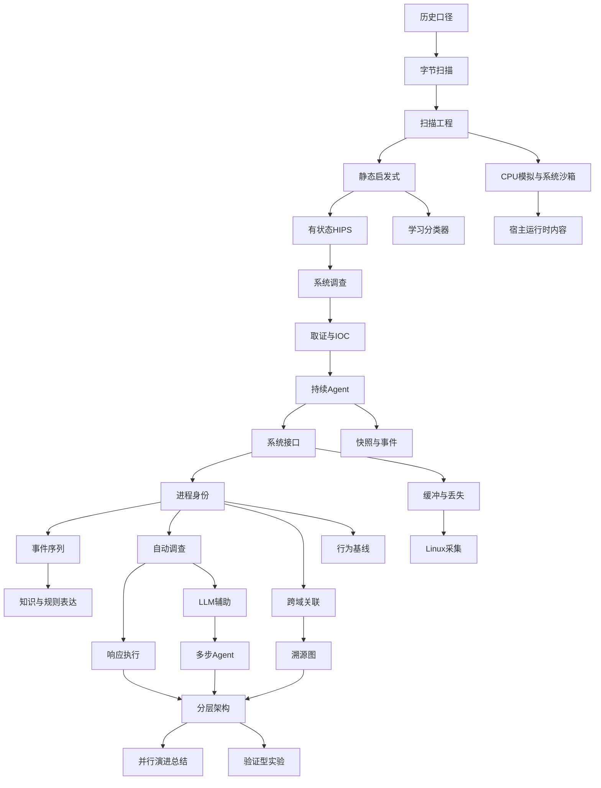

# EDR知识DAG：28个节点与文件映射

## 一句话
DAG表示阅读与实现依赖，不表示技术依次发明或旧技术被淘汰；实体溯源图也不必天然是DAG。

## 主干

图展示主干；下表为每节点的直接前置和落地位置。编号沿用研究文章，部分节点共享一个原子专题，不为凑文件数机械拆开。

| 节点 | 内容 | 直接前置 | 文件/章节 |
|---|---|---|---|
| N00 | 历史与代码口径 | 无 | [主线导言](README.md) |
| N01 | 字节特征 | N00 | [特征扫描](signature-scanning.md) |
| N02 | 掩码、多模式、格式与摘要 | N01 | [特征扫描](signature-scanning.md)、[地址](pe-addresses.md) |
| N03 | 静态启发式 | N02 | [启发式](heuristic-detection.md)、[PE实验](pe-heuristic-demo.md) |
| N04 | CPU模拟与系统沙箱 | N02 | [模拟](cpu-emulation.md)、[沙箱](sandbox-api-monitoring.md) |
| N05 | 有状态运行时策略 | N03 | [HIPS](hips-stateful-policy.md) |
| N06 | 调查与影响范围 | N05 | [远程取证](remote-forensics-ioc.md) |
| N07 | IOC复查与对象边界 | N06 | [远程取证](remote-forensics-ioc.md) |
| N08 | 持续Agent | N07 | [Windows采集](windows-telemetry.md) |
| N09 | 接口可见性与字段 | N08 | [Windows采集](windows-telemetry.md) |
| N10 | 实例身份与关系 | N09 | [进程身份](process-identity.md) |
| N11 | 队列、传输与丢失 | N09 | [缓冲](telemetry-buffering.md) |
| N12 | 状态查询与事件记录 | N08 | [Windows采集](windows-telemetry.md) |
| N13 | AMSI与脚本内容 | N04 | [AMSI](amsi-runtime-content.md) |
| N14 | 行为序列 | N10 | [CEP](cep-event-patterns.md) |
| N15 | ATT&CK与Sigma | N14 | [主线6.3](README.md)、[CEP](cep-event-patterns.md) |
| N16 | 学习特征组合 | N03 | [静态ML](ml-static-detection.md) |
| N17 | 自动调查 | N10 | [调查与响应](response-automation.md) |
| N18 | 响应任务与系统效果 | N17 | [调查与响应](response-automation.md) |
| N19 | XDR跨域实体 | N10 | [XDR](xdr-entity-correlation.md) |
| N20 | Linux采集扩展 | N11 | [eBPF](linux-ebpf-telemetry.md) |
| N21 | 统计画像 | N10 | [基线与图](behavior-baselines-graphs.md) |
| N22 | 关系图与图学习 | N19 | [基线与图](behavior-baselines-graphs.md) |
| N23 | LLM证据组织 | N17 | [AI调查](ai-assisted-investigation.md) |
| N24 | 受控多步调查 | N23 | [AI调查](ai-assisted-investigation.md) |
| N25 | 完整系统分层 | N18,N22,N24 | [主线9.1](README.md) |
| N26 | 并行演进轴 | N25 | [主线9.3](README.md) |
| N27 | 验证路线 | N25 | [实验目录](experiments/README.md) |

## 审计
回到节点时应能回答：旧方案为什么失效？新增哪些输入和状态？什么代码使用这些输入？正例、反例和未知路径分别输出什么？源码在哪里，是否真的运行过？

## 易错
N21放在后面是为了复用遥测和身份知识，不是统计画像在2023年才发明。N17的自动化至少有2018年的产品资料，N04包含不同年代的两种环境；阅读依赖不应冒充历史首创表。

返回：[知识索引](knowledge-index.md) · [历史主线](README.md)
